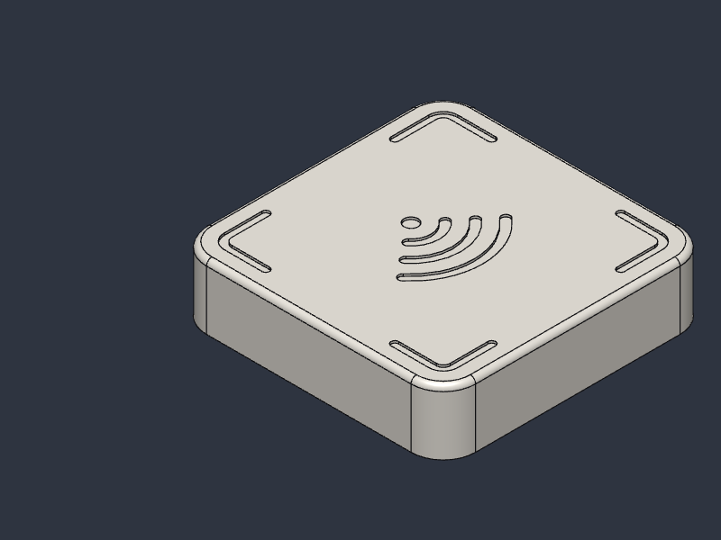

# The Lodestone Project

Open-source, 3D-printable objects that help you put your phone down.

A lodestone is a naturally magnetic stone. These are small, heavy, physical pods that hold onto your attention so your phone doesn't. Each one is designed to be printed, assembled with cheap off-the-shelf parts, and repaired, by anyone.



## Pods

| Pod | Status | What it does |
|---|---|---|
| [Focus Pod](focus-pod/) | Design complete, first print pending | A weighted NFC tile (50 × 50 × 15 mm, ~87 g). Tap your iPhone to lock distracting apps; tap again to unlock. |
| [Night Pod](night-pod/) | Not started | Planned |

## Repository layout
```
focus-pod/   CAD (parametric source + STEP), print files, BOM, assembly guide, renders
night-pod/   coming soon
```

## License
Copyright William Depatie 2026.

This source describes Open Hardware and is licensed under the CERN-OHL-S v2 ([LICENSE](LICENSE)).

You may redistribute and modify this source and make products using it under the terms of the CERN-OHL-S v2 (https://ohwr.org/cern_ohl_s_v2.txt). This source is distributed WITHOUT ANY EXPRESS OR IMPLIED WARRANTY, INCLUDING OF MERCHANTABILITY, SATISFACTORY QUALITY AND FITNESS FOR A PARTICULAR PURPOSE. Please see the CERN-OHL-S v2 for applicable conditions.

Source location: https://github.com/bluecodesthings/lodestone-project

In plain terms: anyone can build, modify and sell Lodestone pods. If you share or sell a modified version, you must publish your modified source under the same license.

## Credits
- iPhone app side builds on [Foqos](https://github.com/awaseem/foqos) (MIT).
- The concept is inspired by commercial phone-blocking devices such as Brick. This project is independent and not affiliated with any of them.
