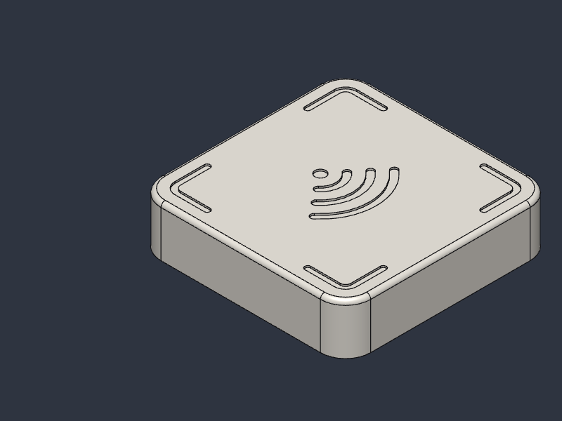
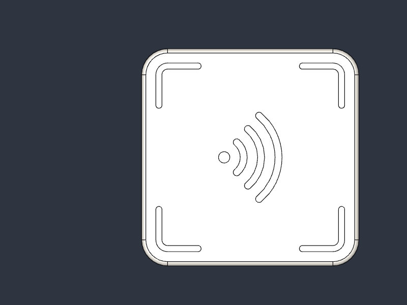
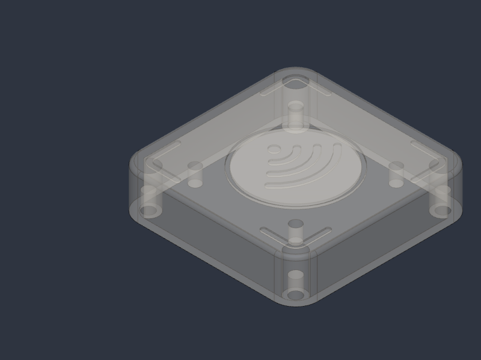
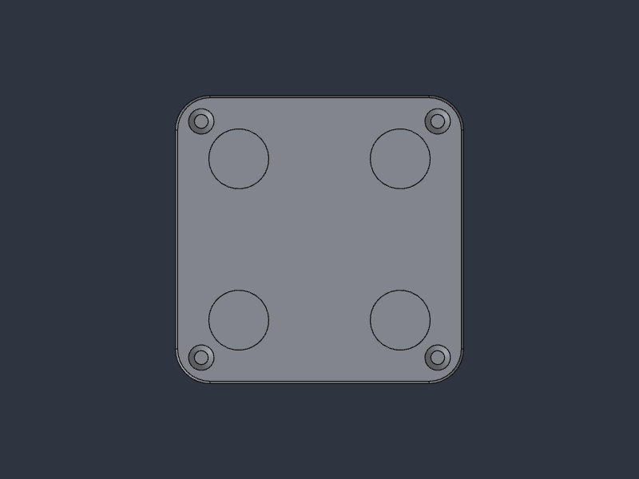

# Lodestone Focus Pod

Part of [The Lodestone Project](../README.md). A DIY, 3D-printable, weighted NFC "focus pod" for iPhone, inspired by the Brick. Tap your phone on it to lock distracting apps, and tap again to unlock. The pod is a printed shell with a steel weight and a cheap NFC sticker inside. A custom build of the open-source [Foqos](https://github.com/awaseem/foqos) app handles the iPhone side.

> Not affiliated with or endorsed by Brick. This is an independent, homemade design.



| Top | Inside (top shown see-through) | Bottom |
|---|---|---|
|  |  |  |

## Specs
- **Size:** 50 × 50 × 15 mm, 6 mm rounded corners
- **Top:** a generic "tap here" wave symbol and 4 corner bracket marks, recessed 0.4 mm
- **Weight:** about 87 g (19.5 g PLA + 64.6 g steel + hardware)
- **Parts:** 2 printed parts (top and base), a steel plate, an NFC tag, 4 × M2 screws into brass heat-set inserts, and 4 silicone feet
- **Repairable:** remove 4 screws to get to the tag. The feet don't cover the screws.
- **Cost:** about $5 CAD per pod once you have the multi-packs (see [BOM.md](BOM.md))

## How it's built
```
 ┌──────── 1.2 mm ceiling (the phone reads through this) ────────┐
 │   NFC tag (25 mm) in a locating ring                           │
 │   ~3.4 mm air gap (keeps the steel from detuning the tag)      │
 │ pins▼  [ steel 38.1 × 34 × 6.35 mm ]               ▲ inserts   │  TOP
 ├─ ledge (aligns the parts, holds the steel) ────────────────────┤
 └─ BASE 3 mm: 4 countersunk M2 screws + 4 foot pockets ──────────┘
```

## Files
| Folder | Contents |
|---|---|
| `print/` | `pod-top` and `pod-base` as `.3mf` and `.stl`, plus [print settings](print/print-settings.md) |
| `cad/` | `lodestone-focus-pod.sc` (parametric SolidCraft source), `.step` files for any CAD program, and an assembly STEP with the steel |
| `docs/` | [Assembly guide](docs/assembly.md) |
| `app/` | Notes on the iPhone app (Foqos fork) |

## Customising
The `.sc` file is fully parametric. The main parameters (mm):

| Name | Default | What it does |
|---|---|---|
| `L` | 50 | Outer width/length |
| `H` | 15 | Total height |
| `R` | 6 | Corner radius |
| `wall` | 2 | Side wall thickness |
| `ceil_t` | 1.2 | Top thickness (keep it thin for NFC range) |
| `base_t` | 3 | Base plate thickness |
| `clr` | 0.2 | Fit clearance (raise it if parts are tight on your printer) |
| `st_w` / `st_l` / `st_t` | 38.1 / 34 / 6.35 | Steel plate size, for 1½″ × ¼″ flat bar |
| `boss_off` | 20.5 | Screw position from the centre |
| `insert_d` / `insert_depth` | 3.2 / 5 | Heat-set insert hole |
| `foot_d` / `foot_depth` / `foot_off` | 10.4 / 1 / 14 | Foot pockets |
| `tag_d` | 26 | Tag locating ring inner diameter |
| `engrave_d` | 0.4 | Depth of the top symbol and corner marks |

The symbol and corner marks are fixed sketches drawn for the 50 mm size. If you change `L`, move the corner marks in `CornerMarkSketch`.

If you use metric bar (e.g. 40 × 6 mm), change `st_w`/`st_t`. Check that the steel corners still clear the screw bosses, or increase `L`.

## License
CERN-OHL-S-2.0. See the [project license](../LICENSE). The Foqos-based iPhone app keeps its own MIT license.

## Credits
- iPhone app: [Foqos](https://github.com/awaseem/foqos) (MIT license).
- Concept inspired by the Brick focus device.
