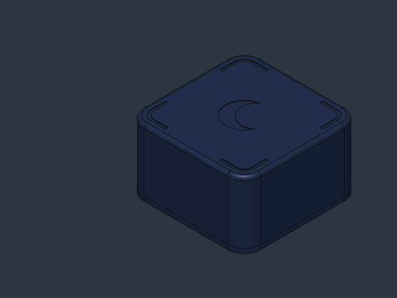
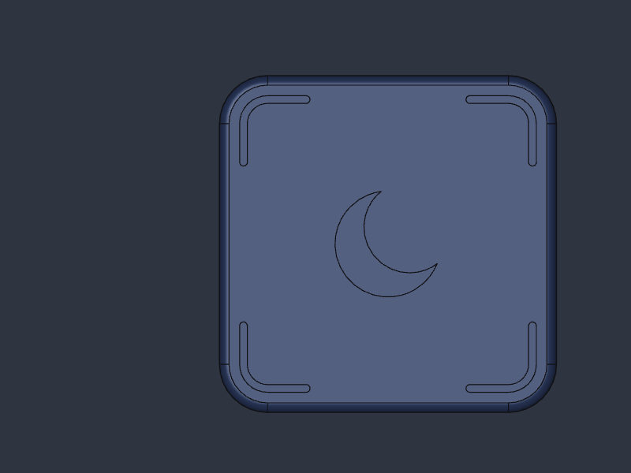
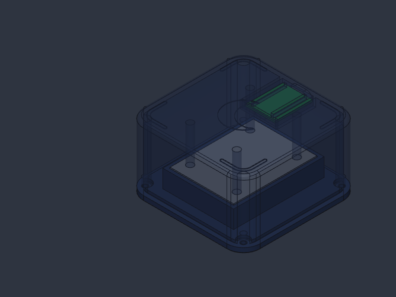
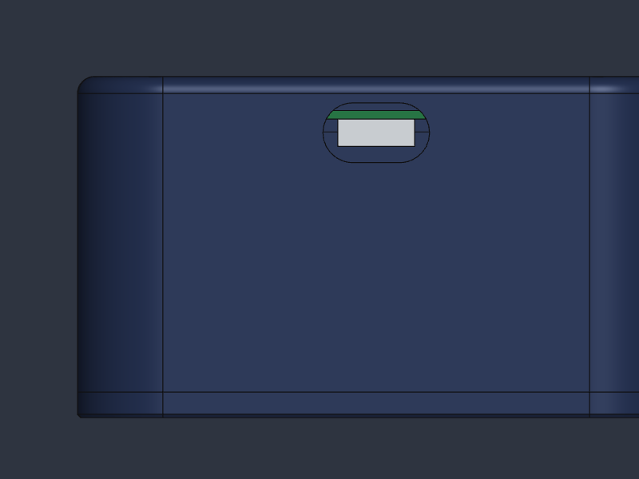

# Lodestone Night Pod

Part of [The Lodestone Project](../README.md). A bedside Bluetooth beacon: when your iPhone comes into range (your bedroom) during night hours, the companion app blocks your chosen apps automatically. When you leave, or the night schedule ends, it unblocks them. No tapping is needed.

> Inspired by Brick Night. Not affiliated with or endorsed by Brick.



| Top | Inside (top shown see-through) | Back (USB-C) |
|---|---|---|
|  |  |  |

## Specs
- **Size:** 70 × 70 × 40 mm, 10 mm rounded corners, an engraved crescent moon and corner marks on top
- **Weight:** about 265 g with two steel plates (about 170 g with one)
- **Electronics:** an ESP32-C3 SuperMini running the open [Lodestone beacon firmware](firmware/), powered by USB-C
- **Range:** adjustable from about one room to a whole apartment by setting the transmit power over USB (no re-flashing)
- **Repairable:** remove 4 screws from the bottom and the top lifts off with the board
- **Shared parts:** uses the same steel bar, M2 inserts and screws, and silicone feet as the [Focus Pod](../focus-pod/)
- **Cost:** about $10 CAD per pod plus printing (see [BOM.md](BOM.md))

## How it works
```
 ┌──── 2 mm top (crescent + corner marks) ─────┐
 │  [ESP32-C3 on a snap-in cradle] ──USB-C──▶   │  back
 │                                              │
 │  pins▼ [ steel × 1–2 ]               ▲ boss  │  TOP
 ├── ledge + steel tray ────────────────────────┤
 └── BASE: 4 × M2 countersunk + 4 feet ─────────┘
```
1. The pod broadcasts an **iBeacon** (Lodestone UUID + major/minor) every 300 ms.
2. iOS monitors that beacon in the background and wakes the app when you enter or leave its range, even if the app is closed.
3. The app checks your night schedule (e.g. 10 pm–7 am) and starts or stops blocking.

The zone follows signal strength, not walls, so calibrate it for your room (see the [firmware README](firmware/README.md)). Leaving the zone takes about 30 s to register, which is how iOS handles beacon exits.

## Files
| Folder | Contents |
|---|---|
| `print/` | `pod-top` and `pod-base` (`.3mf`/`.stl`), [print settings](print/print-settings.md), [McGill-ready files](print/mcgill-submission/) |
| `cad/` | `lodestone-night-pod.sc` (parametric SolidCraft source) and STEP files, including an assembly with the steel and board |
| `firmware/` | Arduino sketch for the ESP32-C3 + [setup guide](firmware/README.md) |
| `docs/` | [Assembly guide](docs/assembly.md) |

## Customising (main parameters, mm)
| Name | Default | What it does |
|---|---|---|
| `L` / `H` / `R` | 70 / 40 / 10 | Width, height, corner radius |
| `wall` / `ceil_t` / `base_t` | 2.4 / 2 / 3 | Wall, top and base thickness |
| `st_n` | 2 | Number of stacked steel plates (1 or 2). The tray and hold-down pins adjust automatically. |
| `st_w` / `st_l` / `st_t` | 38.1 / 50 / 6.35 | Steel plate size (1½″ × ¼″ bar cut to 50 mm) |
| `pcb_l` / `pcb_w` / `pcb_t` | 22.5 / 18 / 1 | Board size. **Measure your board with calipers.** |
| `usb_w` / `usb_h` | 12.5 / 7 | USB-C opening for the cable plug |
| `clr` | 0.2 | Fit clearance |

## App
The beacon trigger is planned for the Lodestone Foqos fork (see [../focus-pod/app](../focus-pod/app/)). Until then, you can check the beacon with any BLE scanner app such as nRF Connect.

## License
CERN-OHL-S-2.0. See the [project license](../LICENSE).
